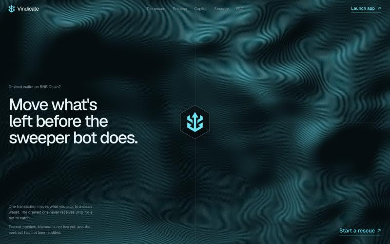
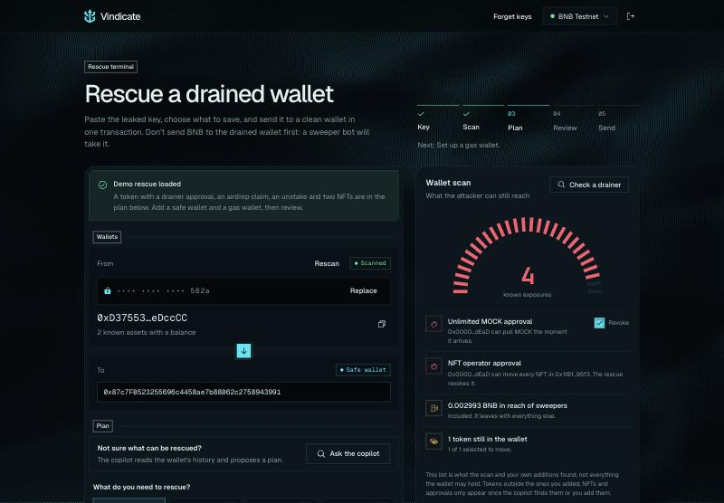

# Vindicate

[](LICENSE)

Move what is left in a drained BNB Chain wallet to a safe one in a single transaction, before a
drainer or sweeper bot takes it.

Vindicate uses [EIP-7702](https://eips.ethereum.org/EIPS/eip-7702), live on BNB Chain since the
Pascal hard fork. The compromised wallet is delegated to a small contract (the delegation stays
until it is cleared, and does nothing without a new signature). In one
transaction it revokes selected token and operator approvals, runs any claim you need, transfers
selected ERC-721/ERC-1155 assets, and sweeps selected ERC-20 tokens and BNB to your safe wallet. A
separate gas wallet pays, so no BNB is ever sent to the drained wallet for a bot to catch.

An optional **rescue copilot** reads the wallet's on-chain history, works out what can still be
revoked, claimed, unstaked or moved, and proposes the plan. An AI model chooses among steps the
code has already built and checked; it never writes an address, an amount or calldata, and the
owner still reviews and signs.

It works for any freely transferable BEP-20, including tokenized real-world assets. A token whose
issuer restricts transfers (a frozen or allow-listed one) cannot be rescued this way. The copilot
detects that and leaves it out of its plan; a plan built by hand that includes one is stopped at
review, before anything is sent, and goes through once the token is unticked.





## How it works

1. **Scan.** The app reads BNB, a short list of well-known tokens and any existing EIP-7702
   delegation straight from the chain. Other tokens, NFTs and approvals are added by hand or
   found by the copilot.
2. **Sign locally.** The compromised key signs an EIP-7702 authorization and one EIP-712
   instruction. The instruction is bound to your safe wallet, the gas wallet, a one-time nonce and a
   10-minute deadline.
3. **Send once.** The gas wallet submits the transaction to the compromised address. Revokes, calls,
   NFT transfers and sweeps run in order, and either all land or none do.

## The rescue copilot

Most victims do not know which contract holds their stake or their unclaimed airdrop. The copilot
is the part that finds out.

1. **Code investigates.** `web/src/lib/copilot/investigate.ts` reads the wallet's transfers and
   approvals, checks balances, simulates a transfer of every token (so a frozen one is caught),
   and probes contracts the wallet put value into for an exit that goes through right now.
2. **Code builds a menu.** `plan.ts` turns the findings into candidate steps, each with an id.
3. **A model picks from the menu.** `model.ts` sends the findings, the menu and the owner's note
   to Claude and gets back ids and reasons. Anything not on the menu is dropped, and a blocked
   step stays out whatever the model says.
4. **The owner reviews and signs** in the app, exactly as for a plan built by hand.

Without `ANTHROPIC_API_KEY` the copilot still investigates and plans by rules, and says so.

Limits worth knowing:

- A call is only checked to go through, not for what it pays.
- History is read about a week back (1.4 million blocks), in windows the RPC allows.
- Public BNB Chain RPCs only answer history searches inside named contracts, so there the note
  must list the addresses involved. An RPC that serves wide `eth_getLogs` ranges (set it as
  `COPILOT_RPC_BSC_TESTNET`, server side only) lets the copilot find contracts on its own.
- The route is rate limited per caller, but it has no login. Put a spend cap on the model key
  before hosting it publicly.

## Security model

- **No key ever leaves the browser.** Keys are used only in the browser to sign, and are kept in
  memory only. The compromised key enters through a masked form and is never shown again in full.
  (The key of a gas wallet the app generated can be revealed on request, to recover leftover gas.)
- **The copilot never receives a key.** The optional rescue copilot (`/api/copilot`) is the one
  server route. It receives the compromised wallet's address, the safe wallet's address if
  entered, and the owner's note; a note that looks like a private key is refused. It reads the
  chain and builds a menu of steps, each checked on its own (a call is checked to go through,
  not for what it pays). The note and those findings are sent to an AI model, which picks from
  the menu by id and explains its picks. The model never writes an address, an amount or
  calldata, and the owner still reviews and signs.
- **Inert delegate.** `VindicateDelegate` acts only on a signature from the wallet it runs in. A
  wallet left delegated cannot be drained by anyone else through it.
- **Locked-down page.** A per-request nonce CSP with `strict-dynamic` allows only the app's own
  scripts and lets the page talk only to the configured RPC endpoints and its own origin (for
  the copilot route).
- **Supply chain.** The lockfile pins resolved dependencies, and pnpm refuses releases younger than
  7 days.

Vindicate has not had an independent audit. See [SECURITY.md](SECURITY.md).

## Business model and roadmap

**The problem, in numbers.** Chainalysis counted about 158,000 compromises of personal wallets
in 2025, hitting at least 80,000 people
([The Block](https://www.theblock.co/post/382477/crypto-hack-2025-chainalysis)). Once a key has
leaked, whatever the thief did not take (a stake, an unclaimed airdrop, NFTs) is stuck: any BNB
sent in for gas is swept before it can be used. The established way out is a manual whitehat
rescue, which only takes cases above 1,000 USD
([Flashbots](https://docs.flashbots.net/whitehat)). Projects rarely let a compromised claimant
redirect an airdrop.

**Why now.** On 29 October 2026 an attacker put an EIP-7702 delegation on a Binance hot wallet
and emptied it three and a half minutes later. The delegation stayed on the wallet and swept
new deposits for hours; Binance cleared it 3 hours 46 minutes after the main sweep
([Elliptic](https://www.elliptic.co/insights/binance-largest-hack-in-history/),
[TRM Labs](https://www.trmlabs.com/resources/blog/north-korea-steals-usd-6-36-billion-from-binance-in-the-largest-hack-in-history),
[Hacken](https://hacken.io/insights/binance-hack/)). Vindicate would not have stopped that: the
attacker could make Binance's own systems sign. What the incident shows is the mechanism this
project is built on, pointed the other way, and it is not rare: a measurement cited in
[IACR 2026/2060](https://eprint.iacr.org/2026/2060) found 63% of observed delegations pointing
at malicious contracts. An exchange can cover a loss from its reserves. A person cannot. What a
person needs is to be told that their wallet now runs someone else's code, and a way to take it
back. The scan already flags a delegation it does not recognise, a rescue replaces it (the
scenario suite covers a wallet the drainer delegated first), and the receipt offers the same
step Binance took at the end: clearing the delegation.

**Who it is for.** A large holder has options: above 1,000 USD a whitehat will take the case by
hand, and a team with money can write its own scripts. Vindicate is built for everyone else:
the long tail below that line, and people who cannot write calldata, which is most victims.
That is why the app has a plain-language investigation and not only a form for contract
addresses. Nobody serves these people because a manual rescue costs an expert's hours, and a
300 USD case cannot pay for them. Software can take that case: the work runs in the victim's
browser and in one transaction, so a small rescue costs almost nothing to serve.

**Where Vindicate fits.** Hosted tools that run a rescue through EIP-7702 now exist on mainnet,
on many chains, charging 10 to 20% of what they move. Running the transaction is becoming a
commodity. What is still hard is knowing what can be rescued and through which contract, and
being sure afterwards what actually happened. That is where this project puts its work: the
copilot's investigation, a delegate that only acts on a signed, single-use instruction, revokes
in the same transaction, a receipt read from the chain rather than from the plan, and a scenario
suite that covers races and tokens that misbehave.

**How it earns.**

- *Success fee.* The delegate takes its fee from the swept tokens and BNB inside the rescue
  transaction, so Vindicate is paid only when something is saved. No minimum, nothing upfront
  (an upfront fee is the mark of a recovery scam); revokes, NFT moves and clearing the
  delegation are free. Testnet uses 10%, and that is the planned mainnet rate: the low end of
  what hosted tools charge.
- *Claim windows.* The largest single cases are tokens that do not exist yet: an airdrop or a
  vesting unlock owed to a compromised wallet. At the 2023 Arbitrum airdrop about 2,400
  compromised wallets were owed roughly 3 million ARB, with a thief waiting to claim it and no
  official route for the owners
  ([The Block](https://www.theblock.co/post/221607/arbitrum-airdrop-arb-wallet-hijack)). A
  rescue prepared in advance and sent the moment a claim opens is the same product, same fee.
- *Partners.* A rescue mode inside a wallet, sharing the fee with the wallet. A claim route for
  airdrop and vesting projects, paid per campaign by the project, which is the party with the
  support queue. Alerts on a wallet's delegation and approvals, sold to wallets per address
  watched.
- *Teams.* A subscription for the plain wallets that small teams run on: deployer keys, bot
  wallets, a DAO's hot wallet. It watches them and keeps a tested revocation and an exit to
  cold storage ready. After October, security firms advise custodians to keep exactly that; the
  tools that offer it today are sold to exchanges and large protocols.
- *Free, on purpose.* Checking a wallet and learning what the result means costs nothing. Most
  people in crypto have never heard of a sweeper bot or a delegation, and victims are the main
  target of fake "recovery agents". Education is how people find the tool before a scammer
  finds them. It is acquisition, not revenue.

**The honest numbers.** Nobody publishes what is left behind in a drained wallet, so this is an
assumption and not a measurement: if 1% of 158,000 compromised wallets a year ran a rescue that
moved 500 USD, the fee would total about 79,000 USD. Self-serve rescues alone do not carry a
company. Claim windows and partners have to, and they depend on trust the project has not
earned yet. The contract is MIT, so anyone may deploy it with no fee. What a fork would not get
is what the roadmap builds on top: the library of protocol exits, a list of drainer and sweeper
contracts fed by every scan, and the distribution.

**Open risks.**

- *The tool cannot tell an owner from a thief.* Both hold the key. A thief gains little (they
  already run their own scripts and would pay the fee), but a hosted version must still screen
  the receiving wallet against sanctions lists.
- *The race is real.* A bot that holds the key can move first. Sending through a private RPC
  narrows that window and does not close it; the suite covers rescues where the attacker moves
  first.
- *"Paste your key into a website" is what scams ask for.* A hosted page cannot answer that.
  An offline, signed build can.

**Roadmap.** A plan, not shipped work. Each stage has to hold before the next starts.

0. **Shipped, on BNB testnet.** The delegate, the app, the copilot, the receipt, 49 on-chain
   scenarios. See [Deployments](#deployments).
1. **Trust.** An independent audit and verified source. A build that runs offline from a signed
   release. Rescues sent through a private-transaction RPC by default. A check by address, with
   no key, that anyone can run on a wallet they are worried about.
2. **BNB Chain mainnet.** Deployment at the final rate. Gas paid by a relayer that receives
   signatures and never keys, so a victim does not need a second funded wallet. Indexed history,
   so the copilot finds a wallet's positions without being given addresses. Exit recipes for
   the largest BNB Chain protocols, as open, reviewable files. Rescues scheduled for a claim
   window. Measured from day one: rescues completed, value moved, and how often a bot wins the
   race.
3. **Every chain with EIP-7702.** A leaked key is leaked on every EVM chain at once, at the
   same address. One scan across chains, one signed plan per chain, the same delegate at the
   same address everywhere. Hosted tools already cover many chains, so this is catching up, not
   a lead; BNB Chain comes first because that is where the recipes and the testing are.
4. **Distribution.** A rescue mode inside a wallet, where the key already lives and the user
   already trusts the software. A claim route for airdrop and vesting projects. Open tooling
   for whitehat responders, who today work from scripts. For permissioned real-world-asset
   tokens that only their issuer can move, an evidence pack the holder can take to the issuer
   (ERC-3643, for one, lets an issuer recover tokens from a lost wallet).
5. **Cutting a drain short.** For wallets that are still healthy. First a watch: an alert the
   moment a wallet gains a delegation or an unlimited approval it did not have, or loses funds
   to a known sweeper. Then an exit: a recovery address the owner registers in advance behind a
   time lock, and a pre-signed rescue that can only pay that address, sent when the watch fires.
   The delegate already allows it: an instruction may leave the executor open, and it sweeps
   whatever the balance is when it runs. This does not beat a thief who delegates and sweeps in
   one transaction. It wins when there is a gap (on the Binance wallet, three and a half
   minutes) and it gets to the stake, the vesting and the NFTs before the thief comes back for
   them, which today takes a victim days. Offered through wallets and security tools that
   already protect users, not as a product of its own.

## Repository

| Path | What |
| --- | --- |
| [`contracts/`](contracts) | Foundry project: `VindicateDelegate`, tests, deploy script |
| [`web/`](web) | Next.js 16 app: landing page (`/`) and the rescue app (`/app`) |
| [`web/DESIGN.md`](web/DESIGN.md) | Design system |
| [`docs/architecture.md`](docs/architecture.md) | Architecture and data flow |

## Getting started

Requirements: Node 24+, pnpm 12.18.0, and [Foundry](https://getfoundry.sh).

```bash
git clone --recurse-submodules https://github.com/r1afif18/Vindicate.git && cd Vindicate
cd contracts && forge build && forge test && cd ..
cd web && pnpm install
pnpm dev:chain   # terminal 1: local BNB-testnet-like chain with the delegate and demo assets
pnpm dev         # terminal 2: http://localhost:3000
```

`pnpm dev:chain` prints a compromised key, a gas wallet key and practice wallets to try the whole
flow, and writes `web/.env.local` for it. Paste the printed key in the app, scan, then press
"Load the demo rescue".

### Trying it on BNB testnet

The app talks to whatever `web/.env.local` names. For the deployed testnet contract:

```bash
NEXT_PUBLIC_DELEGATE_BSC_TESTNET=0xbe0C880AB5AF238b798D384355AdB7BE29d7F1EB
NEXT_PUBLIC_RPC_BSC_TESTNET=https://bsc-testnet-rpc.publicnode.com
ANTHROPIC_API_KEY=            # optional: lets a model write the copilot's plan
```

To get practice wallets there (a token with a drainer approval, an airdrop, two stakes, NFTs):

```bash
cd web && TESTNET_FUNDER_KEY=0x… node scripts/testnet-practice.mjs   # about 0.04 tBNB
```

It refuses any chain but 97, writes the throwaway wallets and their keys to a file outside the
repository, and points `.env.local` at the testnet.

### Checks

```bash
cd contracts && forge fmt --check && forge test
cd web && pnpm check && pnpm build   # formatting, lint, types, tests, and production build
cd web && pnpm vitest run --config e2e/vitest.config.ts   # 49 rescue scenarios on a local chain
```

The scenario suite starts its own Anvil and runs real rescues: every asset kind, replays, races
with the attacker, tokens that misbehave, and the copilot's investigation end to end. With
`TESTNET_DELEGATE` and `TESTNET_FUNDER_KEY` set it also runs two rescues on BNB testnet.

### Deploying the contract

```bash
cd contracts
cp .env.example .env              # TREASURY, FEE_BPS, RPC URLs, explorer key
cast wallet import deployer --interactive
forge script script/Deploy.s.sol --rpc-url bsc_testnet --account deployer --broadcast --verify
```

Then set `NEXT_PUBLIC_DELEGATE_BSC_TESTNET` (or `_BSC`) in `web/.env.local`.

## Deployments

| Network | Contract | Address | Fee |
| --- | --- | --- | --- |
| BNB Smart Chain Testnet (97) | `VindicateDelegate` | `0xbe0C880AB5AF238b798D384355AdB7BE29d7F1EB` | 10% |

Not deployed on mainnet yet. The contract has not been audited.

Rescues sent through the app on testnet:

- [Ten steps in one transaction](https://testnet.bscscan.com/tx/0x3ec31fd197af0623d1dca34e68a3accfed2bde8335a16ec35d2eafba21099828):
  two revokes, an airdrop claim, an unstake, an ERC-721, ERC-1155 items, and three sweeps.
- [A plan proposed by the copilot](https://testnet.bscscan.com/tx/0x641c7a1ac6c45b8b0ee6bd31d0d48a15287a223bee32fc3c27aeec2a3cbc6071):
  it found a token stake and left out a frozen token.

## License

[MIT](LICENSE)
